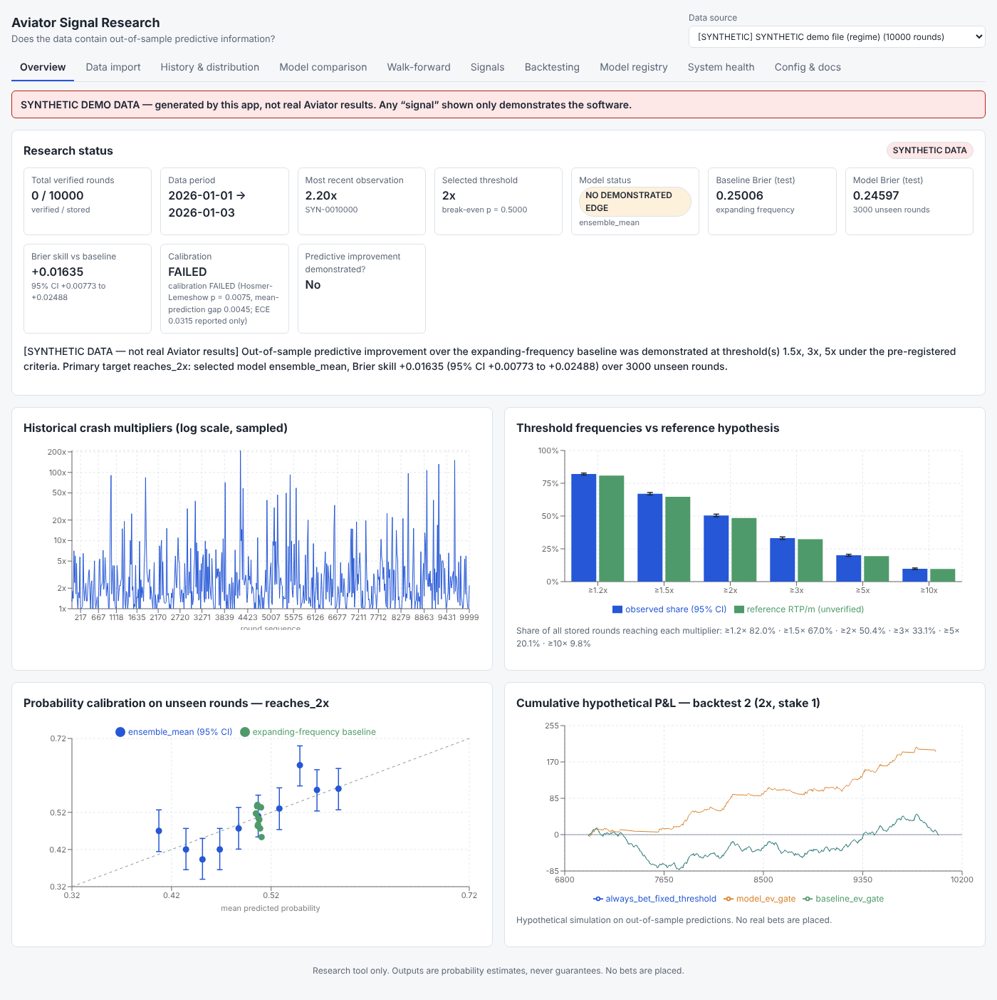
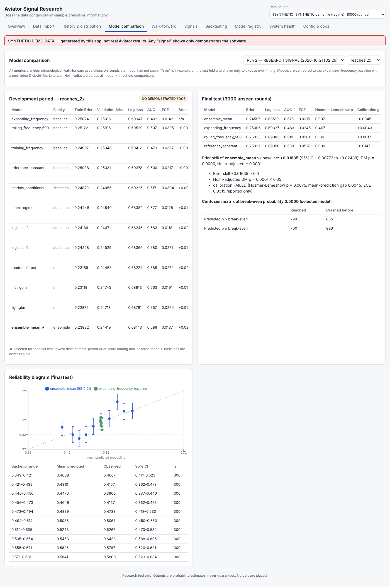

# Aviator Crash-Game Signal Research Platform

A reproducible research system that answers one question honestly:

> **Do legitimately available Aviator round results contain information that predicts the next round better than
> a simple historical-frequency baseline, on rounds the model has never seen?**

It ingests and validates round data, runs a pre-registered chronological walk-forward evaluation of baseline,
statistical and machine-learning models, stores every prediction immutably *before* its outcome is known, converts
calibrated probabilities into transparent research signals (`INSUFFICIENT EVIDENCE` / `NO DEMONSTRATED EDGE` /
`RESEARCH SIGNAL`), and backtests hypothetical cash-out policies with an independent audit.

It does **not** place bets, connect to gambling accounts, bypass anti-bot protection, or attempt to obtain seeds or
server state. Public documentation and publicly visible round results can be collected politely (robots.txt,
rate limits, honest User-Agent). It ships **3,000 real rounds observed on Spribe's public Aviator demo**
(`data/observed/`, 97.8% fairness-verified) plus synthetic demo data that is labelled as such everywhere.

---

## Quick start (local)

**New to this? Follow the step-by-step guide for your own PC: [docs/SETUP_GUIDE.md](docs/SETUP_GUIDE.md).**

Requirements: Python 3.11+ (tested 3.13), Node 18+ (tested 22).

```bash
cd aviator_signal_research

# 1. Backend
python -m venv .venv && source .venv/bin/activate
pip install -r backend/requirements-dev.txt
cd backend && uvicorn app.api.main:app --port 8000      # API + docs at http://localhost:8000/docs

# 2. Frontend (second terminal)
cd aviator_signal_research/frontend
npm ci
npm run dev                                              # dashboard at http://localhost:5173
```

In the dashboard: **Data import** → upload your CSV/JSON (or load a synthetic demo) → **Walk-forward** → start an
evaluation → inspect **Model comparison**, **Signals**, **Backtesting**.

### Docker

```bash
cd aviator_signal_research
cp .env.example .env          # optional
docker compose up --build     # dashboard http://localhost:8080, API http://localhost:8000
```

### Command line (reproducible runs)

```bash
python scripts/research_cli.py make-demo            # regenerate the synthetic demo CSVs
python scripts/research_cli.py import my_export.csv --source operator-x --kind historical_export --timezone Europe/Berlin
python scripts/research_cli.py evaluate --source operator-x
python scripts/research_cli.py backtest --run 1 --threshold 2
python scripts/research_cli.py demo-report          # full synthetic end-to-end run -> reports/
python scripts/research_cli.py collect-docs https://spribe.co/games/aviator   # official rules/RTP/fairness text
python scripts/research_cli.py observe <public game URL> --source my-observed --minutes 60
```

Collection obeys robots.txt, rate-limits, and stops on CAPTCHA/anti-bot pages. See
**[docs/COLLECTION.md](docs/COLLECTION.md)** for the tool evaluation (Scrapling parser + httpx + official
Playwright) and what was verified.

### Tests

```bash
cd backend && python -m pytest            # backend: ingestion, features, leakage, metrics, walk-forward,
                                          # evaluation, backtest, signals/live, API (~5 min)
cd frontend && npm test && npm run build  # dashboard states + typecheck + production build
```

---

## Project layout

```
aviator_signal_research/
├── backend/
│   ├── app/
│   │   ├── config.py            # env-based settings + pre-registered EvaluationProtocol
│   │   ├── db.py, models.py     # SQLAlchemy schema, immutability triggers
│   │   ├── ingestion/           # parsers, validation, import service (raw kept separately)
│   │   ├── analysis/            # EDA & dependence tests, fairness-metadata audit
│   │   ├── features.py          # causal feature definitions + look-ahead audit
│   │   ├── modeling/            # estimators, metrics, walk-forward, evaluation, regression
│   │   ├── signals.py           # next-round signal engine (immutable predictions)
│   │   ├── backtest.py          # event-driven backtest + independent audit
│   │   ├── live.py              # data-mode / feed-staleness, FeedAdapter interface
│   │   ├── reporting.py         # markdown report from stored runs
│   │   ├── synthetic.py         # generators with KNOWN properties
│   │   └── api/main.py          # FastAPI app
│   ├── tests/                   # pytest suite
│   ├── requirements*.txt, Dockerfile
├── frontend/                    # React + TypeScript + Recharts dashboard (10 screens)
├── data/demo/                   # SYNTHETIC demo datasets (not real results)
├── docs/                        # METHODOLOGY, LIMITATIONS, API, TROUBLESHOOTING, report template
├── reports/                     # generated evaluation reports
├── scripts/research_cli.py
├── docker-compose.yml, .env.example
```

## Key design decisions

| Decision | Why |
|---|---|
| Threshold probability (reach M?) is the primary target; exact multiplier is secondary | Cash-out decisions depend on P(X ≥ M); point error on a heavy-tailed variable is not decision-relevant |
| Expanding-frequency baseline; every model must beat it on a Holm-adjusted DM test | "Better than chance" is meaningless; "better than the obvious estimate" is the real bar |
| 70/30 chronological split, untouched final test, single pre-registered candidate per threshold | Prevents tuning on the test period and selection-by-luck |
| Commit-before-reveal ledger + DB triggers blocking UPDATE/DELETE on predictions | Proves predictions were made in advance |
| Look-ahead audit on every run; failure forces INSUFFICIENT EVIDENCE | A leakage bug otherwise looks like a breakthrough (see `test_leakage_bug_cannot_produce_a_signal`) |
| Calibration gate = Hosmer–Lemeshow + calibration gap, ECE reported only | Fixed ECE cut-offs reject well-calibrated models on ~1k-round samples |
| SQLite by default, PostgreSQL via `AVR_DATABASE_URL` | Zero-setup prototype; immutability triggers exist for both |
| Collectors read only what any visitor sees (robots.txt, rate limit, stop on CAPTCHA); no account, no betting | No documented, authorised Aviator data API is known; public demo observation + per-round provably-fair check is the legitimate route |

See **[docs/METHODOLOGY.md](docs/METHODOLOGY.md)** for the full protocol and
**[docs/LIMITATIONS.md](docs/LIMITATIONS.md)** for limitations and the list of components that need real data or
external integration. API: **[docs/API.md](docs/API.md)**. Problems: **[docs/TROUBLESHOOTING.md](docs/TROUBLESHOOTING.md)**.

## Results so far

**Real data (3,000 Spribe demo rounds, 21–22 Oct 2026): NO DEMONSTRATED EDGE at 1.5x, 2x, 3x and 5x.** On 900
unseen rounds the best model matched the frequency baseline (Brier skill at 2x +0.00015, 95% CI −0.0015 to
+0.0018; Holm DM p = 0.53). Its yes/no accuracy equalled "always predict the more likely side". All 2,933 rounds
with revealed seeds were re-derived exactly from the provably-fair hash (0 mismatches). The frequencies match
`P(X ≥ m) = 0.97/m`, and no dependence test is significant. Past rounds do not predict the next one.

On synthetic data the same pipeline detects a deliberately planted dependence, which shows that the negative result
is not a blind spot of the framework. Full details: **[reports/FINAL_REPORT.md](reports/FINAL_REPORT.md)**.

## Screenshots (synthetic regime demo)




## Responsible use

This is a research and statistics tool. Crash games are designed with a house edge; under the commonly quoted
(unverified) RTP of 97%, every fixed cash-out strategy loses about 3% of stakes in expectation. A model would have to
beat that edge, out of sample and consistently, before any decision value could exist. If gambling is causing
problems for you or someone you know, seek help from a local support service.
